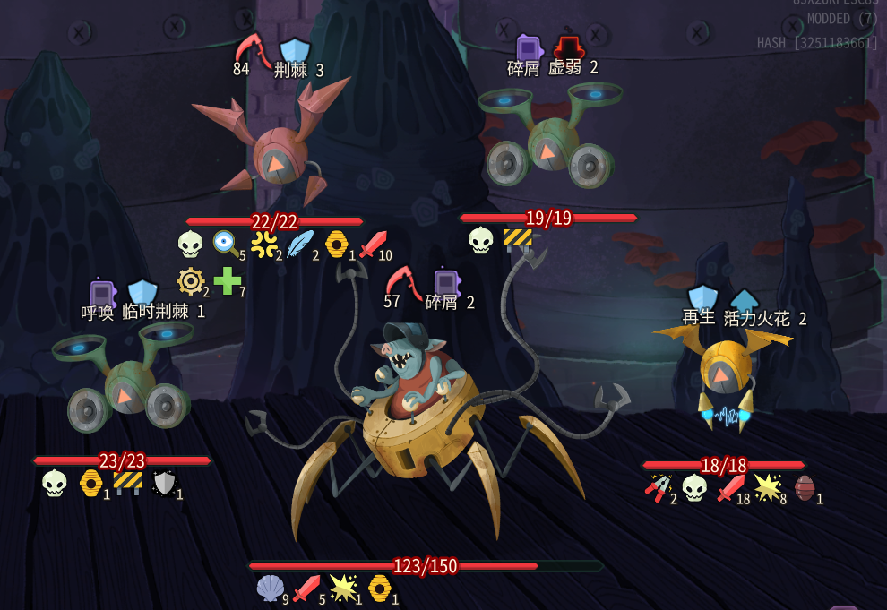

# 怪物意图随机 / Monster Intent Randomizer

为《杀戮尖塔 2》v0.113 系列随机生成怪物招式和开场状态。怪物的行动力、攻击频次和招式偏好来自独立画像。关键脚本招式可保留原版行为，随机意图会在怪物行动前显示。

[Steam 创意工坊 / Steam Workshop](https://steamcommunity.com/sharedfiles/filedetails/?id=3840913980) · [English quick start](#english-quick-start) · [创意工坊发布说明](PUBLISHING.md)



## 安装与设置

通过创意工坊安装时，订阅本模组，再在游戏的模组列表中启用。手动安装时，把包含 DLL 和清单的 `MonsterIntentRandomizer` 文件夹放入游戏的 `mods` 目录。安装后重启游戏。

游戏中打开 **设置 → 常规 → 怪物意图随机 · 设置**。简化菜单的全局行动力倍率和混沌滑动条会自动保存。点击 **完整设置** 进入逐怪参数、状态估值和模拟等页面。在 **逐怪参数** 选中怪物，下方的 **行动偏好** 可以添加招式、修改权重或移除条目。**常用参数** 中可调偏好直占比例的基础值和强度系数。逐怪页也可调整基础行动力、攻击段数偏好、波动及四类意图倾向。

- **全局行动力倍率**决定怪物出招的预算。`1.00×` 对应画像基础值。
- **混沌值**影响出招和开场状态的变化幅度。调高后，招式波动更大，部分高级状态更容易出现。

仪式兽的冲撞和破防阶段在 **逐怪参数** 各占一个条目，可以独立启用和调整。冲撞阶段的随机自身强化仅有力量。

单人模式下，**常用参数**可开启「按本场玩家平均输出调整玩家行动力（10%）」。开启后，玩家行动力估值由房间曲线的 90% 和本场平均输出的 10% 组成。每场战斗的首个玩家回合结束后开始采用实测数据。

状态估值页分为出招效果、怪物强化和开场状态。随机开场强化与战斗中的强化共用 `buffs` 中的公式、房间权重、层数和叠加配置。勾选「独特词条」即可让该效果占用全场共享额度。模拟会标出状态牌在每个去向的张数。点击保存后从下一场战斗生效。配置保存于 `user://mod_data/MonsterIntentRandomizer/config.json`。

游戏启动时可迁移比当前设置修订号早至多 5 版的配置。更早的配置会在日志中提示，并使用当前默认值启动。

每场战斗根据种子初始化一条 Mod 随机序列，开场状态、出招和多段攻击的动画位置沿用同一条序列。实战随机跳样触发后，后续出招接着使用错开后的序列。模拟器按种子运行，实战跳样由系统随机数判定。

## 多人模式

联机各端使用同一版 Mod。房间使用主机建房时的战斗参数和怪物画像，客户端进房时自动接收，保存在本次联机会话中。主机修改参数后，重新建房即可生效。

多人估值使用单人玩家行动力曲线，怪物当前血量和其他怪物血量按原版多人血量倍率折算。联机关闭随机跳样和实战输出修正。常规对玩家效果和塞牌面向全体玩家，减抽牌与减能量按每人可扣除的数量分别结算。配为不可叠加的对玩家效果整场只使用一次。

双击 `tools/sync_parameters.pyw` 打开参数同步窗口。选好文件和同步范围后，可以比较、从游戏拉取或推送到游戏。覆盖前会保留 `.bak`。也可以用 `python tools/sync_parameters.py diff` 在命令行比较。

## 哪些怪物会随机

在 [画像文件](data/monster-profiles.json) 或逐怪参数中，用 `keepMoves` 列出需要保留的原版招式 ID。模拟器用 [预定义招式顺序](data/monster-moves.json) 和正式战斗共用的选招算法生成轨迹。

画像的 `animations` 可指定 `attack`、`buff`、`defend` 和 `playerDebuff` 动画触发名。强化与防御可以共用动画。复合招式含攻击时使用攻击动画。

瀑布巨兽保留原版「增压」和死亡后的爆炸流程。蒸汽喷发的基础权重为 `-100`，瀑布巨兽通过画像中的正偏好将它纳入出招候选。

## 构建

使用本地 .NET 9 与游戏自带的程序集。

```powershell
dotnet build .\mod\MonsterIntentRandomizer.Mod.csproj -c Release
dotnet run -- --check
```

游戏位于其他位置时可传入 `"-p:GamePath=D:\路径\Slay the Spire 2"`。构建同时更新 `dist\MonsterIntentRandomizer`。只需打包时可传入 `-p:InstallMod=false`。命令行原型可用于对照逐怪参数，包含战斗中保留原版行动的怪物。

估值及参数格式见 [设计](DESIGN.md)。

## English quick start

Subscribe through Steam Workshop or copy the `MonsterIntentRandomizer` folder to the game's `mods` directory. Enable the mod in the game and restart.

Open **Settings → General → Monster Intent Randomizer · Settings**. **Global Action Power** raises or lowers the monsters' move budget. **Chaos** controls how much moves and starting effects vary. Both sliders save automatically. **Advanced Settings** opens the monster profiles, effect values, and simulator. The advanced editor currently uses Chinese labels.

Solo changes take effect in the next combat. In co-op, everyone uses the same build, and the lobby host sends their gameplay settings to joining players. Create a new lobby to apply changes to the host's settings.
